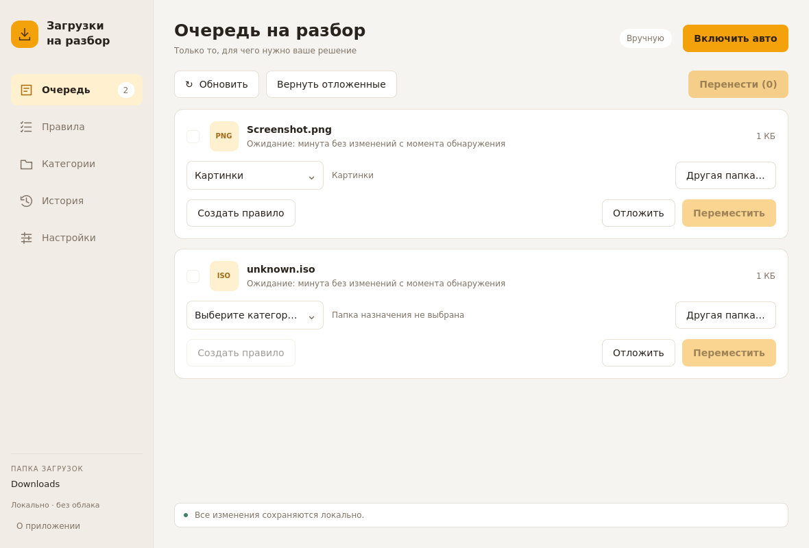

# Загрузки на разбор

Локальное приложение для Fedora KDE Plasma / Wayland: Rust, Qt 6 / QML через CXX-Qt, JSON для настроек и SQLite для истории. Работа офлайн, обновление вручную.

Снимок проверочной сборки с тестовыми файлами.

## Состояние

Разработка в ветке `dev`. Проверочная версия поддерживает предпросмотр верхнего уровня папки, ручной и автоматический перенос в её подпапки на том же диске, историю и отмену. Категории, исключения и упорядоченные правила редактируются в интерфейсе; JSON можно импортировать и экспортировать. Есть светлая, тёмная и системная темы.

При первом запуске предлагается системная папка загрузок. До сохранения настроек обход не запускается. Файл становится доступен для подтверждения после минуты без изменения размера и времени записи с момента обнаружения. Символьные ссылки, папки и временные загрузки пропускаются. Скрытые файлы исключены начальным правилом, которое можно удалить в интерфейсе.

Имя и расширение в одном правиле проверяются совместно. Исключения имеют приоритет, затем срабатывает первое активное правило. По умолчанию включён ручной режим. Перед включением автоматического режима приложение показывает подходящие файлы и просит подтверждение. Затем действие «Переместить» выполняется автоматически после ожидания готовности, а «Предложить» и незнакомые файлы остаются в очереди. Проверка идёт каждые 15 секунд независимо от открытого раздела. Импорт настроек и смена папки возвращают ручной режим.

В настройках можно добавить несколько входящих папок. Новые папки начинают в ручном режиме. Авторазбор включается отдельно для каждой папки, а кнопка «Включить авто» запускает их вместе после предпросмотра. Общая пауза действует на все папки. Привяжите правило к одному источнику или оставьте его общим. Путь категории отсчитывается от папки, откуда пришёл файл. Вложенные друг в друга входящие папки не поддерживаются.

«Только новые» оставляет файлы, уже лежащие в папке при включении настройки, на ручной разбор. Список таких файлов сохраняется при перезапуске. Если отключить настройку, приложение вернётся в ручной режим, чтобы старые файлы снова можно было проверить перед включением авто. Импорт JSON переносит правила и папки, а список старых файлов создаётся заново при включении настройки.

Трей позволяет открыть очередь и папку загрузок, приостановить сортировку и выйти. Закрытие окна оставляет приложение в трее; если трей недоступен, окно закрывается обычным образом. Автозапуск включается отдельно в настройках и использует текущий путь AppImage: после перемещения AppImage отключите и снова включите автозапуск. При входе окно скрывается только при доступном трее.

Перед переносом проверяются метаданные и SHA-256. Совпавшее имя получает суффикс `(2)`; операция переименования никогда не перезаписывает существующий файл. SQLite хранит намерение до переноса и помогает восстановить состояние после сбоя. Отмена проверяет файл и свободный исходный путь. Восстановленные файлы требуют ручного решения.

## AppImage

Стабильные сборки x86_64 публикуются в [GitHub Releases](https://github.com/skyarse/Disassembly-downloads/releases/latest). Скачайте `Downloads-Triage-x86_64.AppImage`, разрешите выполнение в свойствах файла и откройте его. Контрольные суммы и идентификатор исходного коммита доступны рядом с файлом. Проверочные сборки ветки `dev` доступны в [GitHub Actions](https://github.com/skyarse/Disassembly-downloads/actions).

Стабильный AppImage содержит адрес обновлений для [Gear Lever](https://github.com/mijorus/gearlever). Добавьте AppImage в этот менеджер и включите нужный режим обновления в его настройках. Для ручного обновления завершите приложение через трей и замените AppImage. Настройки и история хранятся отдельно. Само приложение работает офлайн.

Для проверки выберите отдельную тестовую папку и положите туда копию PNG и неизвестный ZIP. Просмотрите правило для PNG и включите автоматический режим. Через 60–75 секунд PNG должен оказаться в подпапке «Картинки», а ZIP — остаться в очереди. В «Истории» отмените перенос: PNG вернётся и будет ждать ручного решения. После проверки выберите настоящую папку загрузок и заново включите автоматический режим.

## Настройки и история

- Настройки: `$XDG_CONFIG_HOME/downloads-triage/settings.json`, обычно `~/.config/downloads-triage/settings.json`.
- История: `$XDG_DATA_HOME/downloads-triage/history.sqlite3`, обычно `~/.local/share/downloads-triage/history.sqlite3`.
- Экспорт требует нового имени и не перезаписывает существующие файлы.
- Импорт проверяет настройки перед заменой, автоматически файлы не перемещает.
- Для резервной копии истории закройте приложение и скопируйте папку данных целиком.

## Следующие этапы

Группировка видео с субтитрами, разбор сезонов, папки, игровые комплекты и безопасное копирование между дисками пока не поддерживаются. Названия релизов можно задавать обычными пользовательскими шаблонами. Пауза загрузки больше минуты не означает её завершения: для таких источников нужна отдельная папка завершённых файлов.

## Лицензия

GPL-3.0-only, см. [LICENSE](LICENSE). CXX-Qt — MIT / Apache-2.0, Qt — по лицензиям соответствующих модулей. Сведения и лицензии поставляемых компонентов входят в пакет сборки.
